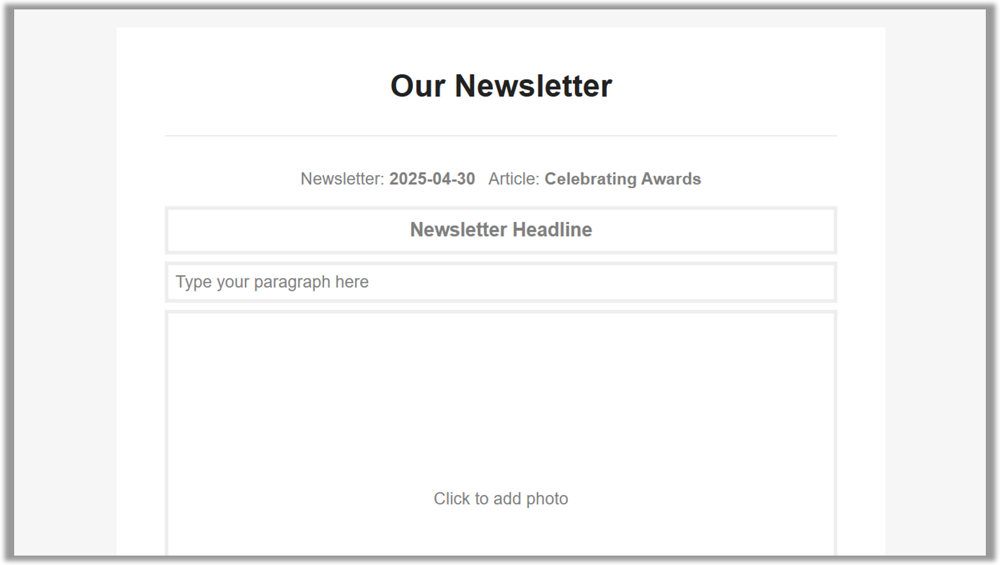

# Newsletter Builder

Newsletter Builder is a free, open-source web application that makes school newsletters a team effort. Easily invite contributors, streamline article creation, and publish vibrant newsletters.

### Features

- Easy-to-use, minimalistic interface
- Articles can be scheduled in advance and assigned to contributors
- Automated reminder emails to keep contributors on track
- Consistent, professional presentation of text and photos
- Photo consent confirmation
- AI-powered feedback on article content and style
- Quality assurance process for editors to check articles before publishing
- Upcoming event calendar included at the bottom of every newsletter
- Recipient management
- One-click publication by email and to a public website
- Single sign-on (SSO) using Microsoft 365

### Setup

1. Create a Postmark server.

2. Create a general purpose v2 storage account in Microsoft Azure.
    - Add private containers: `photos`, `dataprotection`
    - Within the `dataprotection` blob container, upload a blank file `keys.xml`. Generate a SAS URL for this file with read/write permissions and a distant expiry. This will be used to store the application's data protection keys so that auth cookies persist across app restarts.
    - Add tables: `articles`, `events`, `newsletters`, `recipients`, `users`
    - The `users` table needs an initial entry, and this must be a valid user on your Azure tenant:
        - PartitionKey - the email domain of the user (everything after the `@` symbol)
        - RowKey - the email name of the user (everything before the `@` symbol)
        - IsEditor - `true`
        - IsAdmin - `true`
        - FirstName - the user's first name
        - DisplayName - the user's title and surname
    - Enable static website hosting, and set the index document to `index.html` and the error document to `404.html`. This will create a `$web` blob container, which will be the root of the public-facing newsletter website.
    - Customise the contents of the `StaticWebsite` folder in this repository, for example replacing placeholders with their appropriate values. Then upload to the `$web` blob container. Also upload `logo.jpg` (250x250px), `logo-hd.jpg` (1200x1200px), `favicon.ico`, and `icon-192x192.png`.
    - Enable CORS for blob `GET` requests from the domain where the newsletter builder will be hosted (e.g. `https://build.newsletter.example.com`).

3. Create an [Azure AI Foundry](https://ai.azure.com/) project and deploy an OpenAI reasoning model (e.g. `gpt-5.1`) that you would like to use for giving feedback on articles.

4. Create an Azure app registration.
    - Name - `Newsletter Builder`
    - Redirect URI - `https://<your-newsletter-builder-domain>/signin-oidc`
    - Implicit grant - ID tokens
    - Supported account types - Accounts in this organizational directory only
    - API permissions - `Microsoft Graph - User.Read`
    - Token configuration - add optional claim of type ID: `upn`
    - Certificates & secrets - create a new client secret

5. Create an Azure App Service web app.
    - Publish mode - Container
    - Operating system - Linux
    - Image source - Other container registries
    - Container name - `main`
    - Access type - Public
    - Registry server URL - `https://index.docker.io`
    - Image and tag - `jamesgurung/newsletter-builder:latest`
    - Port - 8080
    - Startup command: (blank)

6. Configure the application settings as described below.

    #### Bootstrap settings

    If you wish to load settings from Azure App Configuration, specify one of the following:

    - `AppConfigurationEndpoint` - Azure App Configuration endpoint. Enable the App Service's system-assigned managed identity and grant it the App Configuration Data Reader role.
    - `ConnectionStrings:AppConfiguration` - Azure App Configuration connection string.

    #### Azure App Configuration

    The remaining application settings are loaded from the `Shared:*` and `NewsletterBuilder:*` keys in Azure App Configuration, or from your local configuration:

    - `Address` - the address of your organisation
    - `AIFoundryApiKey` - the API key for your Azure AI Foundry project
    - `AIFoundryDeployment` - the name of the deployed OpenAI model that you would like to use
    - `AIFoundryEndpoint` - the endpoint URL for your Azure AI Foundry deployment, e.g. `https://<project>.cognitiveservices.azure.com/`
    - `BannedWords` - a JSON array of words which are not allowed in articles
    - `BrandAccentColour` - the CSS colour used for the navbar bottom border
    - `BrandColour` - the CSS colour used for the navbar background
    - `DataProtectionBlobUri` - the SAS URL for the keys file you created earlier
    - `DefaultDeadlineDaysBeforePublish` - the default number of days before the publish date that articles are due
    - `EmailDomain` - the domain of your user email addresses and existing storage partition, e.g. `example.com`
    - `Footer` - the footer text to include in emails
    - `FromEmail` - the email address from which newsletters and reminders will be sent
    - `MicrosoftClientId` - the client ID of your Azure app registration
    - `MicrosoftClientSecret` - the client secret of your Azure app registration
    - `MicrosoftTenantId` - your Azure tenant ID
    - `NewsletterEditorUrl` - the URL of the newsletter editor
    - `NewsletterUrl` - the URL of the published newsletter
    - `OrganisationName` - the name of your organisation
    - `PhotoConsentUrl` - the URL of the photo consent spreadsheet
    - `PostmarkServerToken` - the token for your Postmark server
    - `QualityAssuranceEmail` - the email address to which quality assurance requests will be sent
    - `ReminderReplyTo` - the reply-to address for reminders
    - `Reminders:0:DaysBeforeDeadline` - the number of days before the publish date to send the first reminder (subsequent reminders can be set up by adding additional items with incrementing indices)
    - `Reminders:0:Message` - the message to include in the reminder email
    - `Reminders:0:Subject` - the subject of the reminder email
    - `Reminders:0:Time` - the time of day to send the reminder email, in the format `HH:mm` (24-hour clock)
    - `SocialMediaEmail` - the email address to receive requests to share the newsletter on social media
    - `StorageAccountKey` - the key for your Azure Storage account
    - `StorageAccountName` - the name of your Azure Storage account
    - `SyncApiKey` - a secret GUID which is used to authenticate requests to the sync API, if you wish to use this feature
    - `TwitterHandle` - the Twitter handle of your organisation, starting with an @ symbol
    - `UnlistedArticles` - a comma-separated list of article names which should not be listed on the index page, for example regular standing items

### Contributing

If you have a question or feature request, please open an issue.

To contribute improvements to this project, or to adapt the code for the specific needs of your organisation, you are welcome to fork the repository.

Pull requests are welcome; please open an issue first to discuss.
